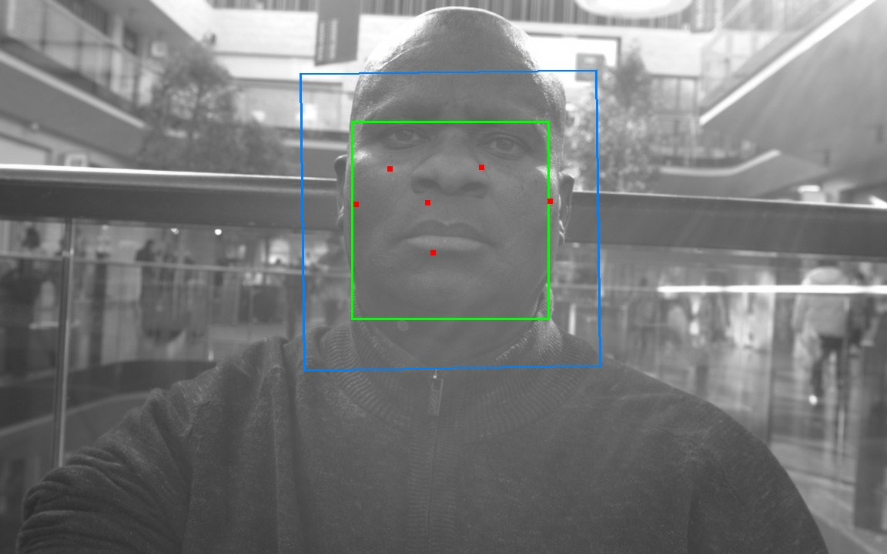
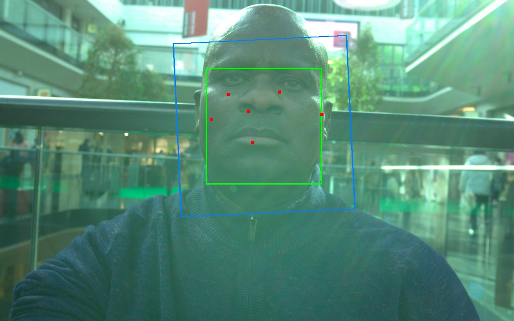
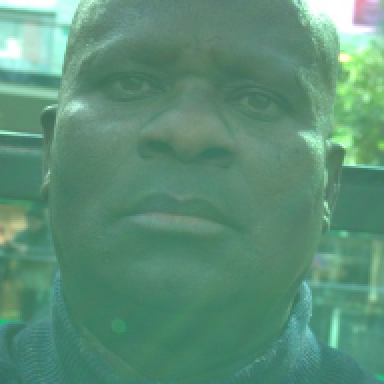
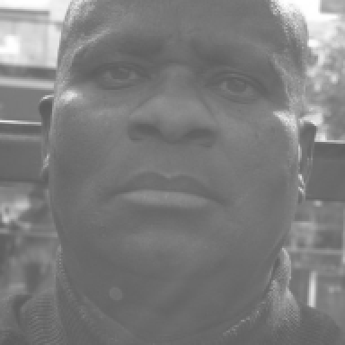
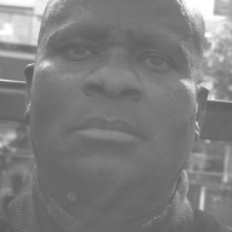
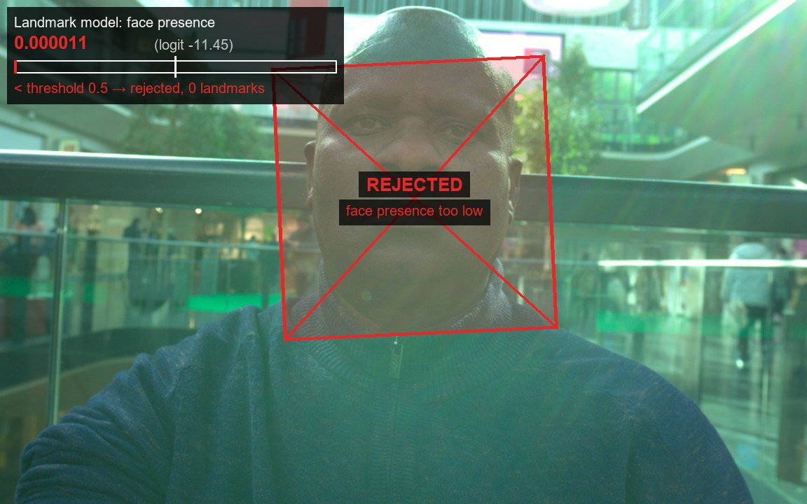
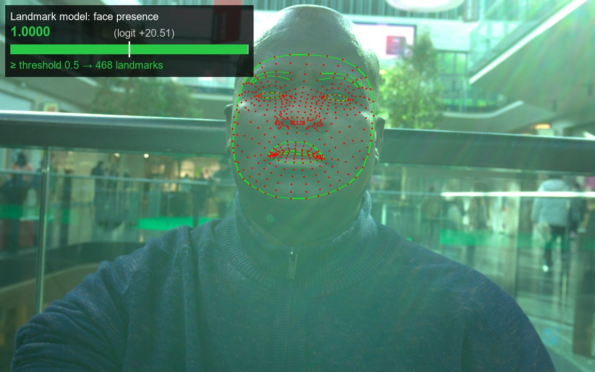
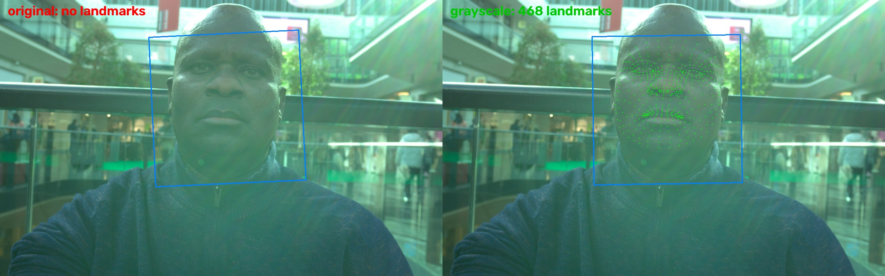

# Face detected, but no landmarks

- **Frame:** `pj1__e96caf44cd6f4c8c97d6423f4dc2d1ee__s1/000000.jpg` (1152×720)
- **Pipeline:** `FaceDetection(SHORT)` → `face_detection_to_roi` → `FaceLandmark` (same as `intelliprove_ml.detect_landmarks`)
- **Scope:** this one frame only
- **Date:** 2026-10-28

## Summary

- **Face detection works:** score 0.82, correct ROI.
- **The landmark model rejects the crop:** face-presence score 0.000011 (logit −11.45), threshold 0.5. It returns `[]`, so `detect_landmarks` raises `NoFaceDetectedError`.
- **Cause: the green colour cast on the face.** Contrast and brightness are not the problem.
- **Fix: grayscale only the landmark model's input.** Face detection stays on colour. Score 1.0, 468 landmarks.

## Comparison

| | Original | Grayscale (detection + landmarks) | **Colour detection + grayscale crop** |
|---|---|---|---|
| **Detection + ROI** |  |  |  |
| **Landmark input** (192×192 crop) |  |  |  |
| **Result** |  |  |  |
| Detection score | 0.816 | 0.811 | 0.816 |
| Presence logit / score | −11.45 / 0.000011 ❌ | +20.51 / 1.0 ✅ | +20.31 / 1.0 ✅ |
| `detect_landmarks` | `NoFaceDetectedError` | 468 landmarks | 468 landmarks |

- **Legend:**
  - Green box = detection
  - Red dots = detector keypoints
  - Blue box = landmark ROI
  - Bar = presence score
  - White tick = 0.5 threshold
- **Colour detection + grayscale crop vs full grayscale:**
  - Landmarks differ by 1.42 px on average (max 4.62 px), 0.79% of the inter-ocular distance.
  - In effect, both give the same landmarks.

## Cause: colour, not contrast

Each row is the full pipeline on a modified frame:

| Preprocessing | Face G/R | Face contrast (std) | Presence | Landmarks |
|---|---|---|---|---|
| None | **1.52** | 8.6 | 0.000011 | ❌ |
| Contrast ×2 | 2.72 | 17.2 | 0.000018 | ❌ |
| Brightness ×1.5 | 1.52 | 12.8 | 0.000012 | ❌ |
| Desaturate 50% | 1.23 | 8.6 | 0.61 | ✅ (barely) |
| Autocontrast (per channel) | 1.34 | 10.9 | 0.9997 | ✅ |
| Gray-world white balance | 0.95 | 9.4 | 1.0 | ✅ |
| Histogram equalisation | 0.96 | 24.6 | 1.0 | ✅ |
| Grayscale | 1.00 | **8.6** | 1.0 | ✅ |

- **Grayscale has the same contrast as the original (8.6) yet passes**, so colour decides.
- **More contrast or brightness alone does not help.**
- **How much the cast is reduced predicts the result:** desaturate < autocontrast < white balance and grayscale.

## Why the detector succeeds and the landmark model fails

- **Detector (BlazeFace):**
  - Whole frame at 128×128, coarse face shape and 6 keypoints.
  - Robust to colour.
- **Landmark model (FaceMesh):**
  - 192×192 close-up of the face.
  - Has a separate face-presence output, thresholded at 0.5 (`DETECTION_THRESHOLD`).
- **Green skin is likely outside its training data:**
  - On the face, green is about 1.5× red; natural skin is red-dominant.
  - Logit −11.45 is a confident rejection, not a borderline one.
- **Pipeline is correct:** detection, ROI and crop all look right.

## Reproduced in `intelliprove-ml`

- Same frame through the production `detect_landmarks`, using `fdlite` tag 0.1.3.
- Original: `NoFaceDetectedError`.
- Grayscale: 468 landmarks.

## Recommendation

- **Grayscale only the landmark model's input:**
  - In `detect_landmarks`, pass a grayscale copy to `detector.landmark(...)`.
  - Tested on this frame and it works.
- **Keep BlazeFace on the colour frame:**
  - It already works.
  - Changing its input would change detection and the face count for the single-face check (SWR-16) without fixing anything.
- **Keep the colour frame downstream** (ROIs, skin mask, rPPG): landmarks are normalised coordinates, so they map 1:1.
- **Don't lower `DETECTION_THRESHOLD`:** a forced result is a generic face mesh, not real landmarks.
- **Before shipping, validate on many sessions** (lighting, skin tones, bystanders):
  - `NoFaceDetectedError` and `MultipleFacesDetectedError` rates must not get worse.
  - Landmark position and stability must match colour where colour already works.

## Code

- `code/analyse_frame.py`:
  - Generates all `img/` images (except the intelliprove-ml one) and prints all numbers.
  - Run: `python reports/landmark-failure/code/analyse_frame.py [<frame.jpg>]` (this repo's Poetry env).
- `code/intelliprove_ml_temp_script_landmarks.py`:
  - Copy of `intelliprove-ml/temp_script_landmarks.py`.
  - Produced `img/intelliprove_ml_original_vs_grayscale.jpg`.
  - Run in the intelliprove-ml env.
